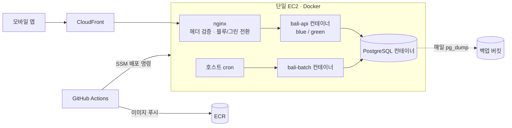

# 시스템 구조 (현재 상태)

이 문서는 **현재 운영 구조**를 설명하는 단일 문서입니다. 구조가 바뀌면 이 문서를 먼저 갱신합니다.
기능별 설계 배경은 [`docs/specs/`](./specs/README.md)의 설계서를 보세요. 설계서는 작성 시점의 기록이라
구조가 바뀐 뒤에는 이 문서와 다를 수 있습니다.

## 한눈에 보기

- 사용자 요청은 CloudFront를 거쳐 서버의 nginx로 들어옵니다. nginx는 CloudFront가 붙인 비밀 헤더가 없는
  요청을 거부해서, 서버 주소로 직접 접근하는 것을 막습니다.
- API와 데이터베이스(PostgreSQL)는 같은 서버 한 대에서 Docker 컨테이너로 실행됩니다.
- 서버는 SSH 포트를 열지 않고, 접속과 배포 명령은 AWS SSM으로만 합니다.

## 모듈 구조

| 모듈 | 역할 |
|---|---|
| `bali-core` | 도메인 모델, 포트 인터페이스 |
| `bali-infra` | JPA 구현체, Flyway 마이그레이션 |
| `bali-api` | REST API 서버(인증, 컨트롤러) |
| `bali-batch` | 분석·알림·세션 정리 배치(웹 서버 없이 실행하고 종료 코드만 반환) |

`bali-api`와 `bali-batch`는 `bali-core`/`bali-infra`를 공유하지만 따로 배포합니다. 라이트 헥사고날 구조이며
도메인과 포트는 `bali-core`에만 둡니다.

## 배포 흐름

1. 기능 브랜치에서 `develop`으로 PR을 보내면 CI(테스트)가 실행됩니다. `develop` 병합은 배포하지 않습니다.
2. `develop`을 `main`에 병합하면 CD가 실행됩니다. 테스트 통과 후 arm64 이미지를 커밋 sha 태그로 빌드해
   컨테이너 레지스트리에 올립니다.
3. 배포 스크립트를 서버로 동기화하고 SSM으로 실행합니다. 스크립트는 **블루/그린** 방식입니다.
   - 반대 색상(blue ↔ green)으로 새 버전 컨테이너를 띄웁니다.
   - 헬스체크가 통과하면 nginx가 가리키는 대상을 바꾸고, 잠시 뒤 이전 버전을 내립니다.
   - 헬스체크가 실패하면 전환하지 않고 기존 버전을 그대로 유지합니다.
4. 롤백은 CD 워크플로우를 수동 실행하면서 이전 커밋의 sha를 지정해 다시 배포합니다.

스키마 변경은 두 버전이 잠시 같은 DB를 쓰므로, 컬럼 삭제나 이름 변경처럼 이전 버전을 깨는 마이그레이션은
두 번에 나누어 배포합니다.

## 배치

배치는 서버의 호스트 cron이 `bali-batch` 컨테이너를 실행합니다. 한국 시간 기준입니다.

| 작업 | 주기 |
|---|---|
| 세션 정리(자정을 넘긴 진행 중 세션을 중단 처리) | 매일 00:05 |
| 루틴 리마인더 | 매일 09:00 |
| 미활동 알림 | 매일 12:00 |
| 주간 분석 / 주간 요약 푸시 | 매주 월요일 00:00 / 13:00 |
| 월간 분석 / 월간 요약 푸시 | 매월 1일 00:00 / 13:00 |

작업이 0이 아닌 종료 코드로 끝나면 알림을 보냅니다. 로컬 개발에서는 Airflow가 같은 역할을 합니다.

## 백업과 모니터링

- 매일 새벽 DB 전체를 덤프해 백업 버킷에 올리고 30일간 보관합니다. 업로드가 비정상이면 알림을 보냅니다.
- 5분마다 API 응답, 디스크, 메모리를 점검하고 상태가 바뀔 때만 알립니다. 서버 상태 점검 실패와 CPU 크레딧
  부족은 클라우드 알람으로 알립니다. 모든 알림은 이메일로 갑니다.

## 인프라 관리

AWS 리소스는 Terraform(`infra/terraform/`)으로 관리하고, 상태는 원격 저장소(S3 + 잠금)에 둡니다.
서버에서 실행되는 스크립트와 구성 파일은 `infra/deploy/`에 있습니다.
